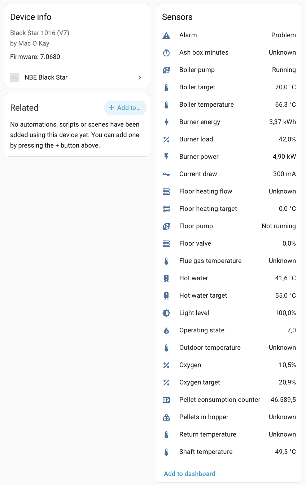
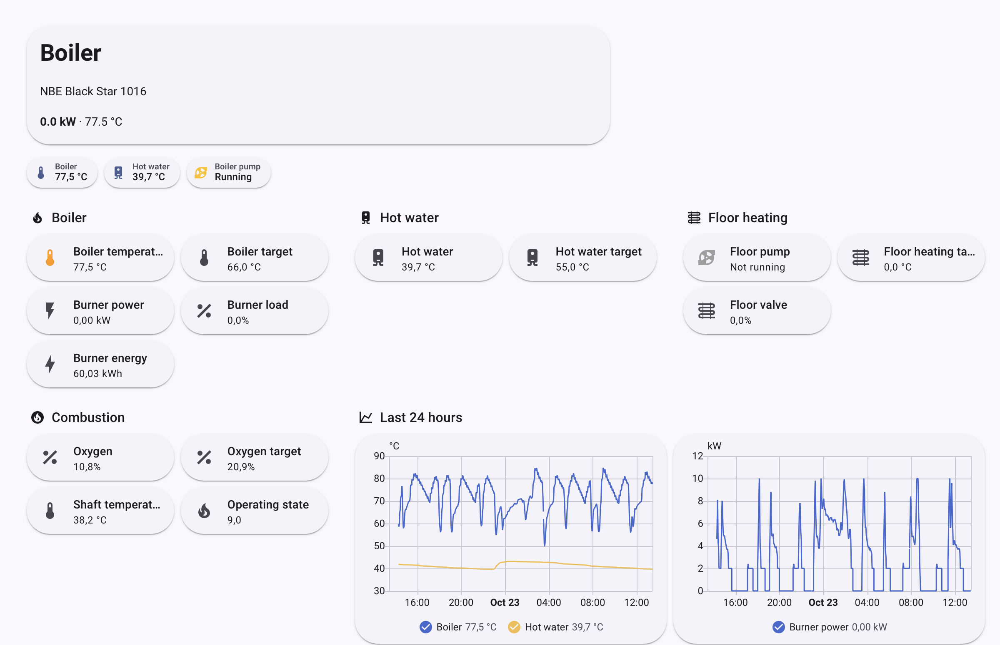
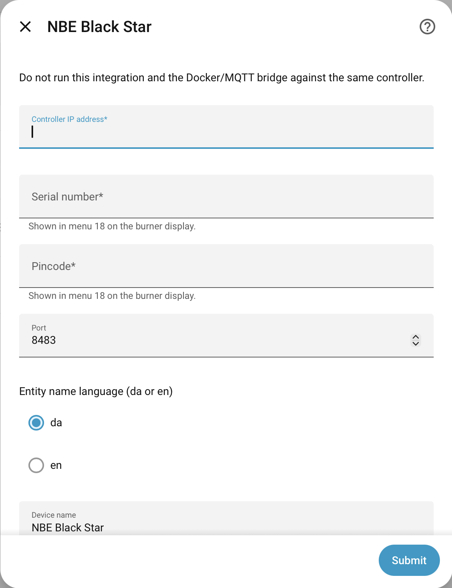
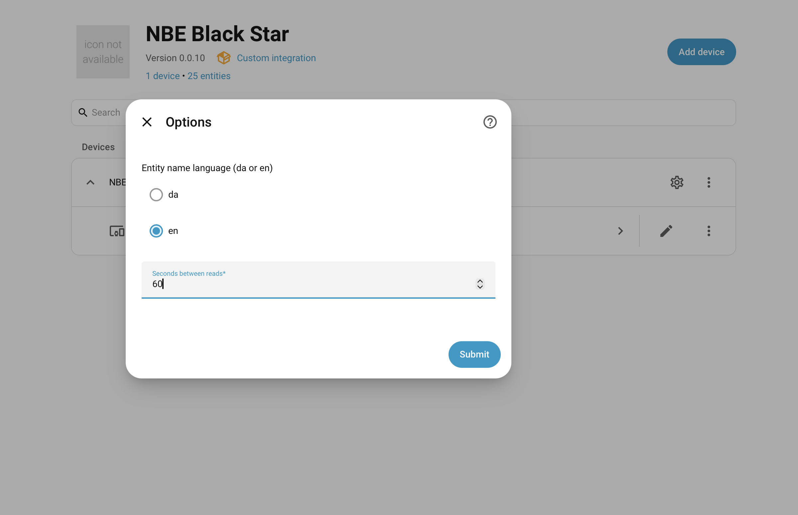

# NBE Black Star (Blackstar+, RTB) for Home Assistant

[](https://github.com/macokay/nbe-blackstar/releases)
[](LICENSE)
[](https://hacs.xyz)

Reads an NBE pellet burner controller (V7 / v13) over the local network and shows its values in Home Assistant: temperatures, burner power and load, pumps, oxygen, operating state and a burner energy total. Read-only: it never changes the burner.

There are two ways to run it. Pick one.

**HACS integration (recommended)**
* Runs inside Home Assistant. No MQTT broker needed.
* Setup: add the repository, enter the controller IP, serial number and pincode.
* Works with Home Assistant only.

**Docker / MQTT bridge**
* Runs as a container or systemd service and publishes to an MQTT broker.
* Setup: environment variables, then MQTT discovery.
* Works with Home Assistant, OpenHAB, ioBroker and Node-RED.

> **Use one, never both against the same controller.** The controller answers one client at a time. Two clients cause request errors and duplicate entities.

> **Status: under development.** Tested with one Black Star 1016 (V7 controller). Entity names and settings may change before 1.0. Feedback and testers with other models are welcome.





## Requirements

* An NBE controller on the local network, with a fixed IP address.
* Its serial number and pincode, both shown in menu 18 on the burner display.
* For the HACS integration: Home Assistant with [HACS](https://hacs.xyz) installed.
* For the Docker bridge: an MQTT broker (for example the Mosquitto add-on) and Docker, or Python 3.14 with `paho-mqtt` 2.1.0 and `pycryptodome` 4.0.0.

## Compatible burners

* NBE RTB 10, 10 VAC, 16, 16 VAC, 30, 30 VAC, 50, 50 VAC, 80 (v13 controller)
* NBE BS+ (Blackstar+) 10, 16, 25 (v13 controller)

Tested with a Black Star 1016 and a V7 controller. Other models are not verified. If you do not know your model, open the burner door and compare with the [NBE manual](https://www.nbe.dk/wp-content/uploads/2017/07/RTB-BS-Manual-V13-ENG-08.03.2017.pdf).

## Install with HACS (recommended)

1. In HACS, open the menu, choose **Custom repositories**, and add `https://github.com/macokay/nbe-blackstar` with type **Integration**.
2. Find **NBE Black Star** in HACS and download it.
3. Restart Home Assistant.
4. Go to **Settings, Devices & services, Add integration** and choose **NBE Black Star**.
5. Enter the controller IP address, serial number and pincode. The port defaults to 8483. Choose `da` or `en` for entity names.



After setup, open the integration and choose **Configure** to change the entity name language and the seconds between reads (default 60).



The pincode is stored only in the config entry (Home Assistant `.storage`) and is never logged. The burner energy total is kept in `nbe_blackstar_energy_<serial>.json` in the Home Assistant config directory, so it survives restarts.

## Install with Docker (MQTT bridge)

Use this if you want MQTT, or a system other than Home Assistant.

```
cp .env.local.example .env.local   # fill in NBE_PASS and MQTT_PASS
docker compose up -d --build
docker compose logs -f nbe
```

The image runs as a non-root user and has a healthcheck. It is unhealthy if the controller has not answered for 5 minutes. Compose builds the image for your machine (amd64 or arm64). Release images for both architectures are published to `ghcr.io/macokay/nbe-blackstar`.

Entities appear through MQTT discovery under the device name from your configuration (default `NBE Black Star`). Sensors use `sensor.nbe_<object_id>`, pumps and alarm use `binary_sensor.nbe_*`.

### Configuration

Every setting comes from an environment variable. `config.json` is optional and may hold non-secret overrides (see `config.json-example`). Secrets are environment-only.

| Variable | Required | Default | Notes |
|---|---|---|---|
| `NBE_SERIAL` | yes | | Controller serial number (menu 18). |
| `NBE_IP` | yes | | Controller IP (use a fixed address). |
| `NBE_PORT` | no | `8483` | Controller UDP port. |
| `NBE_PASS` | yes | | Controller pincode, shown on the burner display (menu 18). Secret. |
| `MQTT_IP` | yes | | MQTT broker host. |
| `MQTT_PORT` | no | `1883` | MQTT broker port. |
| `MQTT_USER` | no | | MQTT user. |
| `MQTT_PASS` | yes | | MQTT password. Secret. |
| `MQTT_CLIENT_NAME` | no | `nbe-blackstar` | MQTT client id. |
| `REFRESH_RATE` | no | `60` | Seconds between reads. |
| `HA_PREFIX` | no | `homeassistant` | Home Assistant discovery prefix. |
| `NBE_DEVICE_ID` | no | `nbe_<serial>` | Device id. Keeps entity topics stable when changed. |
| `NBE_DEVICE_NAME` | no | `NBE Black Star` | Device name in Home Assistant. |
| `NBE_LANG` | no | `da` | Entity names: `da` or `en`. Topics and entity ids do not change with the language. |
| `NBE_DEBUG` | no | `false` | Debug logging. |
| `NBE_ALLOW_WRITE` | no | unset | Leave unset. Writes are not implemented in this build. |

Copy `.env.local.example` to `.env.local`, fill in the secrets, and keep it out of git (it is gitignored).

### Run as a systemd service (without Docker)

1. Create a system user `nbe`.
2. Copy `src/nbe_blackstar/` to `/opt/nbe/nbe_blackstar`.
3. Put all variables from the table in `/etc/nbe/nbe.env` (mode 600).
4. Install the runtime: `python3 -m venv /opt/nbe/venv && /opt/nbe/venv/bin/pip install -r requirements.txt`
5. Copy `nbe.service` to `/etc/systemd/system/`, then `systemctl enable --now nbe`.

## Known gaps

* `Pellets in hopper` (`operating_data/content`) reports negative values on the test controller. It is shown as unknown until the meaning is confirmed.
* The alarm entity is the controller flag `off_on_alarm`. Its meaning is not confirmed, so do not use it for notifications yet.
* The text state of the operating mode and the event log are not decoded yet.
* Return, flue gas and current readings come from the controller manual (menu 15 and 18). Sensors that are not connected show unknown.

See [docs/values.md](docs/values.md) for the full list of readings.

## Development

```
python3 -m venv .venv && .venv/bin/pip install -r requirements-dev.txt
.venv/bin/pytest
```

The tests run offline. They cover the write guard, schema, secrets, frame decoding, entity discovery, query retry and the MQTT last will.

The sensors and their names are defined in `src/nbe_blackstar/nbe_schema`. Columns: `RESOURCE, METHOD, TYPE, NAME, ICON, STATE-CLASS, DEVICE-CLASS, UNIT, OBJECT_ID`.

More: [CHANGELOG.md](CHANGELOG.md), [SECURITY.md](SECURITY.md), [TODO.md](TODO.md), [CONTRIBUTING.md](CONTRIBUTING.md), [docs/runbook.md](docs/runbook.md).

## Credits

Based on [e1z0/nbe-blackstar-homeassistant](https://github.com/e1z0/nbe-blackstar-homeassistant) and the protocol work of Anders Nylund (2013). See [CREDITS.md](CREDITS.md).

## License

This project is licensed under the GNU General Public License v3.0 or later (see [LICENSE](LICENSE)).

Some files keep their original notices:
* `src/nbe_blackstar/protocol.py`, `src/nbe_blackstar/frames.py`: GPL-2.0 or later (Anders Nylund, 2013). Compatible with GPL-3.0.
* `src/nbe_blackstar/bridge.py`, `src/nbe_blackstar/ha_classes.py`, `src/nbe_blackstar/settings.py`: BSD-3-Clause (e1z0, 2021-2022). Compatible with GPL-3.0.
