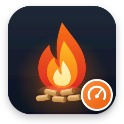

  

<h1 align="center">NBE Black Star</h1>

  Read your NBE pellet burner (Black Star, Blackstar+, RTB) directly in Home Assistant — temperatures, burner power and load, pumps, oxygen and a burner energy total, over the local network and read-only.

  
  
  

  

---

## Features

- Boiler, hot water, floor heating, shaft and outdoor temperatures, with their targets
- Burner power (kW), burner load (%), oxygen and operating state
- Boiler pump, floor pump and alarm as binary sensors
- **Burner energy (kWh)** for the Home Assistant Energy dashboard, integrated from the burner power and kept across restarts
- Pellet consumption counter (kg)
- Entity names in Danish or English
- Read-only: the integration never changes the burner
- Talks to the controller on the local network, no cloud
- A Docker/MQTT bridge is available as an alternative, see [docs/docker.md](docs/docker.md)

  

---

## Requirements

| Requirement | Version / Details |
|---|---|
| Home Assistant | 2025.1 or newer |
| NBE controller | V7 or v13 on the local network, with a fixed IP address |
| Serial number and pincode | Both shown in menu 18 on the burner display |

**Compatible burners:** NBE RTB 10, 10 VAC, 16, 16 VAC, 30, 30 VAC, 50, 50 VAC, 80 and NBE BS+ (Blackstar+) 10, 16, 25 (v13 controller). Tested with a Black Star 1016 and a V7 controller. If you do not know your model, compare with the [NBE manual](https://www.nbe.dk/wp-content/uploads/2017/07/RTB-BS-Manual-V13-ENG-08.03.2017.pdf).

---

## Installation

### Automatic — via HACS

1. Open **HACS** in Home Assistant.
2. Go to **Integrations** → three-dot menu (⋮) → **Custom repositories**.
3. Add `https://github.com/macokay/nbe-blackstar` as **Integration**.
4. Search for **NBE Black Star** and click **Download**.
5. Restart Home Assistant.

### Manual

1. Download the latest release from [GitHub Releases](https://github.com/macokay/nbe-blackstar/releases).
2. Copy the `custom_components/nbe_blackstar` folder to your `config/custom_components/` directory.
3. Restart Home Assistant.

### Alternative — Docker / MQTT bridge

For MQTT, or a system other than Home Assistant, see [docs/docker.md](docs/docker.md). **Use one, never both against the same controller.** The controller answers one client at a time.

---

## Configuration

1. Go to **Settings → Devices & Services → Add Integration**.
2. Search for **NBE Black Star**.
3. Enter the required fields:

| Field | Description |
|---|---|
| Controller IP address | The controller's IP on your network |
| Serial number | Shown in menu 18 on the burner display |
| Pincode | Shown in menu 18 on the burner display. Stored only in the config entry and never logged |
| Port | Controller UDP port. Default `8483` |
| Entity name language | `da` or `en` |
| Device name | Default `NBE Black Star`. Entity names start with it, for example `NBE Black Star Boiler temperature` |

  

Post-setup options are available via **Configure** on the integration card:

| Option | Description | Default |
|---|---|---|
| Entity name language | `da` or `en` | As entered at setup |
| Seconds between reads | How often the controller is read (10 to 3600) | 60 |

---

## Data

### Entities

| Entity | Unit | Description |
|---|---|---|
| `sensor.nbe_kedel_temperatur` | °C | Boiler temperature |
| `sensor.nbe_kedel_maal` | °C | Boiler target |
| `sensor.nbe_varmtvand` | °C | Hot water |
| `sensor.nbe_varmtvand_maal` | °C | Hot water target |
| `sensor.nbe_gulv_fremloeb` | °C | Floor heating flow |
| `sensor.nbe_gulv_oensket` | °C | Floor heating target |
| `sensor.nbe_skakt_temperatur` | °C | Shaft temperature |
| `sensor.nbe_retur_temperatur` | °C | Return temperature |
| `sensor.nbe_rog_temperatur` | °C | Flue gas temperature |
| `sensor.nbe_udetemperatur` | °C | Outdoor temperature |
| `sensor.nbe_braendereffekt_kw` | kW | Burner power |
| `sensor.nbe_braenderbelastning` | % | Burner load |
| `sensor.nbe_braender_energi_kwh` | kWh | Burner energy, for the Energy dashboard |
| `sensor.nbe_ilt` | % | Oxygen |
| `sensor.nbe_ilt_maal` | % | Oxygen target |
| `sensor.nbe_gulv_ventil` | % | Floor valve |
| `sensor.nbe_stromforbrug_ma` | mA | Current draw |
| `sensor.nbe_lysniveau` | % | Light level |
| `sensor.nbe_driftstilstand` | | Operating state (code) |
| `sensor.nbe_pellets_magasin` | kg | Pellets in hopper |
| `sensor.nbe_askeskuffe_minutter` | min | Ash box minutes |
| `sensor.nbe_forbrug_teller` | kg | Pellet consumption counter |
| `binary_sensor.nbe_kedelpumpe` | | Boiler pump |
| `binary_sensor.nbe_gulvpumpe` | | Floor pump |
| `binary_sensor.nbe_alarm` | | Alarm (meaning not confirmed, see below) |

Sensors that are not connected on your burner show unknown. The full list of controller values is in [docs/values.md](docs/values.md).

  

### Update interval

The controller is read every 60 seconds by default (configurable). A missed read is retried once, and the last values are kept until 3 reads in a row have failed.

---

## Updating

**Via HACS:** HACS will notify you when an update is available. Click **Update** on the integration card.

**Manual:** Replace the `custom_components/nbe_blackstar` folder with the new version and restart Home Assistant.

---

## Known Limitations

- `Pellets in hopper` reports negative values on the test controller and is shown as unknown until it is calibrated
- The alarm entity is the controller flag `off_on_alarm`. Its meaning is not confirmed, so do not use it for notifications yet
- The operating state is a code. Its text mapping and the event log are not decoded yet
- The pellet counter unit (kg) is inferred from the burner energy and not yet confirmed on the display
- Tested on one Black Star 1016 with a V7 controller. Other models are not verified

---

## Credits

- [e1z0/nbe-blackstar-homeassistant](https://github.com/e1z0/nbe-blackstar-homeassistant) — the original integration
- Anders Nylund — protocol reverse engineering (2013)

More: [CHANGELOG](docs/CHANGELOG.md), [roadmap](docs/TODO.md), [contributing](.github/CONTRIBUTING.md), [security](.github/SECURITY.md), [credits](docs/CREDITS.md).

---

## License

&copy; 2026 Mac O Kay. Licensed under the GNU General Public License v3.0 or later. See [LICENSE](LICENSE) for details.

Some files keep their original notices: `src/nbe_blackstar/protocol.py` and `frames.py` are GPL-2.0-or-later (Anders Nylund, 2013), and `bridge.py`, `ha_classes.py` and `settings.py` are BSD-3-Clause (e1z0, 2021-2022). Both are compatible with GPL-3.0.
